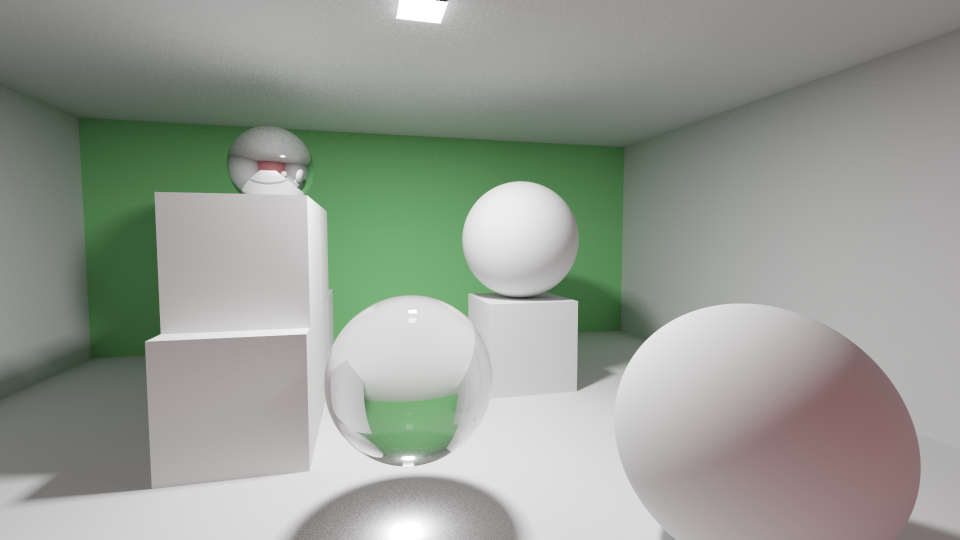

# Rust Path Tracer (Terminal Edition)

A high-performance, interactive path tracer rendered directly in the terminal using Rust. This project demonstrates the intersection of physically based rendering (PBR) and low-resolution terminal output.



*The demo scene rendered with bidirectional path tracing — a green laser beam traced analytically through a two-mirror chain onto the ceiling (a deterministic delta-cone path no Monte-Carlo estimator can sample), indirect color bleeding from the red and green walls, and global illumination.*

## 🚀 Features

- **Bidirectional Path Tracing:** Camera and light subpaths are traced simultaneously and connected at every vertex pair, with multiple-importance sampling (power heuristic, β = 2) to combine all connection strategies without bias.
- **Two Frontends:**
    - **Terminal (`--terminal`):** Interactive preview rendered using terminal half-blocks (`▀`) to double vertical resolution.
    - **Windowed (default, or `--window`):** A native winit window with a wgpu surface. The HDR accumulation buffer is post-processed (denoise + tone map + gamma) entirely in a fragment shader, so pixels never round-trip through the CPU while the camera is stationary. The window title shows accumulated samples and fps; `H` overlays the controls.
- **Temporal Accumulation:** Progressive rendering that averages up to 128 frames while the camera remains stationary, cleaning up noise over time.
- **Firefly Rejection:** Caustic and mirror paths occasionally produce rare, extremely bright samples ("fireflies") that would otherwise paint persistent white dots. Two complementary controls remove them: a per-sample luminance clamp (a loose multiple of the brightest emitter's luminance — a sample far above the brightest emitter is physically implausible, while a rare legitimate caustic sample is *not*, so the clamp stays loose and only removes the implausible tail) and temporal outlier rejection that winsorizes each batch against the pixel's own running statistics (mean + 3σ over an exponential second-moment window), so a firefly leaves no trace in the average while a genuine caustic — many bright batches — keeps converging to its true value.
- **Interactive Exploration:** WASD-style navigation — forward/back, yaw, strafe and pitch (window frontend; the terminal frontend supports forward and yaw).
- **Advanced Post-Processing:**
    - **Bilateral Filtering:** Edge-preserving denoising on the linear HDR buffer to remove path-tracing grain while keeping silhouettes crisp. The range sigma is *relative* (the color distance is scaled by the local mean), so one sigma covers both dark corners and the floor right under a bright emitter — where an absolute sigma in linear HDR would make the filter a no-op exactly where fireflies live.
    - **Extended Reinhard Tone Mapping:** Maps the scene white point to display white (`c(1+c/W²)/(1+c)`), so highlights roll off to pure white instead of plateauing below it.
    - **Gamma Correction:** Linear-to-sRGB conversion (γ = 2.2) for natural lighting.
- **High-Quality Export:** Trigger a full FHD (1920×1080) render at 1024 samples per pixel with up to 8 bounces, saved as a PNG with a progress bar (terminal) or in background batches (window).
- **BVH Acceleration:** Scene geometry is organized in a bounding volume hierarchy (median split along the widest axis, with a subtree early-exit test) for fast ray intersection. The room walls are finite quads, not infinite planes, so their bounding boxes are tight and the BVH can actually cull. Both backends use one: the CPU renderer walks a trait-object tree, the GPU renderer traverses a flat BVH (built on the CPU, uploaded as two storage buffers) with an explicit stack in the shader.

## 🎮 Controls

### Window frontend

| Key | Action |
| :--- | :--- |
| `W` / `S` | Move Forward / Backward |
| `A` / `D` | Turn Left / Right (Yaw) |
| `Q` / `E` | Strafe Left / Right |
| `↑` / `↓` | Pitch Up / Down |
| `F` | Toggle Denoiser |
| `M` | Toggle Laser Sweep Animation (the laser pivots on its table mount; the spot, the glow beside every beam leg, and the derived bridge ladder follow live) |
| `P` | Render High-Quality FHD Screenshot (`screenshot.png`) |
| `H` | Toggle Help Overlay |
| `Esc` | Quit |

### Terminal frontend

| Key | Action |
| :--- | :--- |
| `W` / `S` | Move Forward / Backward |
| `A` / `D` | Turn Left / Right (Yaw) |
| `F` | Toggle Denoiser |
| `P` | Render High-Quality FHD Screenshot (`screenshot.png`) |
| `H` | Show Help |
| `Q` / `Esc` | Quit |

## 🛠️ Technical Details

- **Language:** Rust
- **Parallelism:** Powered by `rayon` for multi-core ray tracing (preview and FHD renders); the GPU backend uses one wgpu compute thread per pixel, intersecting through a flat BVH (one kind-tagged prim array + a 32-byte-node tree, both uploaded once).
- **Terminal Handling:** `crossterm` for raw mode, alternate screen, and ANSI 24-bit color sequences.
- **Windowing:** `winit` 0.30 (`ApplicationHandler`) with a wgpu 30 surface; the display pass reads the accumulation buffer directly (no readback).
- **Image Processing:** `image` crate for PNG export.
- **Light Transport:** Bidirectional path tracing with BSDF-aware sampling (Lambertian diffuse, perfect mirror, GGX glossy microfacets, and dielectric glass with exact Fresnel and Snell refraction), area-light sampling, and MIS power-heuristic weights computed by Veach's incremental-ratio walk over the actual per-edge pdfs. Delta (specular) BSDFs contribute a symbolic pdf that cancels between strategies, and connections through them are excluded from the MIS normalization — specular transport is handled purely by subpath sampling, which is what lets BDPT find caustics that unidirectional path tracing cannot. Glossy vertices are *not* delta: connections through them are valid, so the classic BDPT blind spot softens on its own (paper §9.5).
- **Spectral Transport (paper §9.2):** Radiance is transported as a spectral density at one *hero wavelength* per path, sampled from a branch-aware mixture over the emitters — a laser line's λ is deterministic on its branch (a laser is monochromatic), a smooth emitter's λ is uniform over the visible range. The λ sampling is independent of all direction sampling, so every MIS strategy pdf factorizes as `p(directions)·p(λ)` and the λ factors cancel in every ratio: **the MIS machinery is untouched**. Smooth emitters carry the unique CMF-basis spectrum whose tristimulus integral is exactly the RGB intent (so a white panel renders exactly white in expectation); the sensor converts through the CIE 1931 color matching functions. The demo's lasers are physically correct monochromatic lines — 650 nm red and 532 nm green — replacing the old RGB channel-stuffing hack; their out-of-gamut negative channels gamut-map at display, where they belong.
- **The Laser as a Collimated Beam:** A laser is not a spotlight. The old model — a tiny disc radiating uniformly into a cone, with the emission direction independent of the emission position — is literally the definition of a spotlight, and its artificially wide cone (50–300× the physical divergence) made the spot a soft blob. The new model is power-parametrized: specify the beam power Φ (W) and the physical divergence θ = M²·λ/(π·w₀), and the line's spectral radiance is derived as P = Φ/(A_ap·Ω(θ)). The spot irradiance E = Φ/(π·w₀²) is then *invariant to θ* — θ controls only the divergence, as it physically does (the old radiance-parametrized form coupled them: Φ ∝ Ω at fixed radiance, so θ was secretly a brightness knob, which is why it was left artificially wide). The demo's red laser is a 50 mW presentation pointer (E ≈ 160 W/m² — brighter than the floor under the ceiling panel) and the green a 5 mW pointer (green is ~6× more luminous per watt, so the spots read equally bright); both at M² = 30, so the spot grows visibly across the room while staying a sharp, constant-size beam cross-section. The cone is carried as its *versine* (1 − cos θ, computed in f64): at these divergences the f32 cosine rounds to 1.0 and the cone would collapse to zero solid angle.
- **Dispersion (paper §9.2):** Glass carries Sellmeier dispersion coefficients — the demo's cube is N-BK7 borosilicate, so its caustic picks up chromatic fringes (blue bends more than red). Achromatic glass (constant n) remains supported and pinned by the exact-value tests.
- **Glossy Microfacets (paper §9.5):** A GGX "rough mirror" lobe (NDF sampling, Smith masking, Schlick Fresnel) replaces the perfect mirror where the scene wants soft reflections — the demo's green-laser ping-pong tile. The bridge ladder crosses glossy mirrors along the lobe's mean and remains an unbiased sampling technique; the bridge is the small-roughness limit of the glossy connection.
- **Scene:** A Cornell-box style room — red and green side walls, a ceiling light panel, a partition wall, a table with a glass cube and two thin mirror tiles, and two lasers on the table. The red laser (a 650 nm line, 50 mW) aims at a mirror tile on the back wall, which bounces the beam forward onto the partition; the green laser (a 532 nm line, 5 mW) has its beam ping-pong between the two thin mirror tiles — the first of which is a *rough* GGX mirror, so its reflections are soft while the beam still lands. Each beam's whole path is traced analytically through the real scene at build time (`SceneData::trace_laser_beam` follows the aperture's axis ray across every specular surface until it reaches a diffuse wall), and the aperture's mirror image through *every prefix* of the beam's mirror chain — the classic unfolding construction — is registered as a "specular bridge ladder": one rung per mirror the beam crosses, a sampling technique the BDPT eye walk uses at diffuse vertices, carrying the deterministic delta-cone paths no Monte-Carlo strategy can sample. Rung j is what lights the glow beside the beam's (j+1)-th leg: a diffuse point there sees the aperture through exactly the first j mirrors, which no BDPT connection can reach (the mirrors are delta endpoints) — before the ladder, only the first leg (direct light) and the last leg (the whole-chain image) glowed. Each rung carries the beam direction and the emission cone's versine alongside the image disc, so it samples the *gate-mapped* cone — the smaller of the image-disc cone and the emission cone — which keeps the spot's bridge draws zero-waste at the physical divergences (the aperture's cone gate would otherwise reject ~(Dθ/w₀)² of them and the spot would never converge). The ladder is derived on demand from the fully-built scene (never baked at add-time), so the lasers may be registered before or after the mirrors, and a scene that moves between frames simply re-derives every rung. There is deliberately no beam visible in mid-air: in clean air a laser beam is invisible from the side; only the light deposited on real surfaces is real.
- **Complexity:** Implements a full orthonormal camera basis and a bidirectional path-tracing loop with vertex connection.

## 📦 Getting Started

### Prerequisites
- Rust (Cargo)
- A terminal that supports 24-bit TrueColor (most modern terminals like Alacritty, iTerm2, Windows Terminal, etc.)
- For the windowed frontend: a GPU with Vulkan / Metal / DX12 support

### Running the project
```bash
# Build and run in release mode for maximum performance.
# The windowed frontend is preferred; it falls back to the terminal UI
# when no window system or GPU is available.
cargo run --release

# Force a specific frontend
cargo run --release -- --window     # native window (GPU only)
cargo run --release -- --terminal   # terminal UI (GPU or CPU)
```

### Running the tests
```bash
cargo test
```
The test suite covers the MIS weights (hand-computed values and sum-to-one, including with delta and glossy vertices on the path), the spectral machinery (CIE table anchors, the CMF-comb construction reproducing its RGB intent exactly, the hero-wavelength estimator's unbiasedness, Sellmeier dispersion, the albedo reconstruction's partition of unity), the GGX microfacet BSDF (sampler/eval agreement, reciprocity, the energy bound, the near-mirror limit), light-transport sanity checks (direct hits, shadows, energy bounds, the white furnace, glass energy conservation, the dispersive caustic split), geometry intersection, the bilateral denoiser, temporal accumulation, and offline WGSL validation of both shaders. The two GPU-execution tests (`gpu_matches_cpu`, `gpu_renderer_smoke`) are `#[ignore]`d — they need a real adapter; run them with `cargo test -- --ignored`.

## 📈 Rendering Pipeline
`Ray Generation` $\rightarrow$ `Intersection Testing (BVH, CPU tree / GPU flat-array traversal)` $\rightarrow$ `Bidirectional Path Tracing` $\rightarrow$ `Per-Sample Firefly Clamp` $\rightarrow$ `Temporal Accumulation (with Outlier Rejection)` $\rightarrow$ `Bilateral Filtering (relative σᵣ)` $\rightarrow$ `Extended Reinhard Tone Mapping` $\rightarrow$ `Gamma Correction` $\rightarrow$ `ANSI Terminal Output / wgpu Surface`