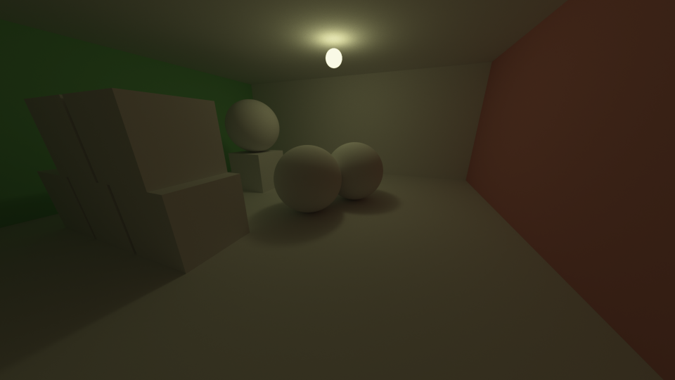

# Rust Path Tracer (Terminal Edition)

A high-performance, interactive path tracer rendered directly in the terminal using Rust. This project demonstrates the intersection of physically based rendering (PBR) and low-resolution terminal output.



*The demo scene rendered with bidirectional path tracing — indirect color bleeding from the red and green walls, soft shadows from the hanging sphere light, and global illumination in the cube stack.*

## 🚀 Features

- **Bidirectional Path Tracing:** Camera and light subpaths are traced simultaneously and connected at every vertex pair, with multiple-importance sampling (power heuristic, β = 2) to combine all connection strategies without bias.
- **Two Frontends:**
    - **Terminal:** Interactive preview rendered using terminal half-blocks (`▀`) to double vertical resolution.
    - **Windowed (`--window`):** A native winit window with a wgpu surface. The HDR accumulation buffer is post-processed (denoise + tone map + gamma) entirely in a fragment shader, so pixels never round-trip through the CPU while the camera is stationary.
- **Temporal Accumulation:** Progressive rendering that averages up to 128 frames while the camera remains stationary, cleaning up noise over time.
- **Interactive Exploration:** Full WASD controls for navigating the scene in 3D space.
- **Advanced Post-Processing:**
    - **Bilateral Filtering:** Edge-preserving denoising on the linear HDR buffer to remove path-tracing grain while keeping silhouettes crisp.
    - **Reinhard Tone Mapping:** Preserves detail in high-intensity emissive areas.
    - **Gamma Correction:** Linear-to-sRGB conversion (γ = 2.2) for natural lighting.
- **High-Quality Export:** Trigger a full FHD (1920×1080) render at 1024 samples per pixel with up to 8 bounces, saved as a PNG with a progress bar.
- **BVH Acceleration:** Scene geometry is organized in a bounding volume hierarchy (median split along the widest axis, with a subtree early-exit test) for fast ray intersection.

## 🎮 Controls

| Key | Action |
| :--- | :--- |
| `W` | Move Forward |
| `S` | Move Backward |
| `A` | Rotate Left (Yaw) |
| `D` | Rotate Right (Yaw) |
| `F` | Toggle Denoiser |
| `H` | Show Help (terminal only) |
| `P` | Render High-Quality FHD Screenshot (`screenshot.png`) (terminal only) |
| `Q` / `Esc` | Quit |

## 🛠️ Technical Details

- **Language:** Rust
- **Parallelism:** Powered by `rayon` for multi-core ray tracing (preview and FHD renders); the GPU backend uses one wgpu compute thread per pixel.
- **Terminal Handling:** `crossterm` for raw mode, alternate screen, and ANSI 24-bit color sequences.
- **Windowing:** `winit` 0.30 (`ApplicationHandler`) with a wgpu 30 surface; the display pass reads the accumulation buffer directly (no readback).
- **Image Processing:** `image` crate for PNG export.
- **Light Transport:** Bidirectional path tracing with cosine-weighted diffuse sampling, area-light sampling, and MIS power-heuristic weights. Every path edge sampled from either subpath has area pdf `G/π`, which keeps the MIS weights simple and exact.
- **Scene:** A Cornell-box style room — red and green side walls, diffuse spheres, a stack of white cubes, and a hanging emissive sphere light that is also sampleable as an area light.
- **Complexity:** Implements a full orthonormal camera basis and a bidirectional path-tracing loop with vertex connection.

## 📦 Getting Started

### Prerequisites
- Rust (Cargo)
- A terminal that supports 24-bit TrueColor (most modern terminals like Alacritty, iTerm2, Windows Terminal, etc.)
- For the windowed frontend: a GPU with Vulkan / Metal / DX12 support

### Running the project
```bash
# Build and run in release mode for maximum performance
cargo run --release

# Native window frontend (GPU only)
cargo run --release -- --window
```

### Running the tests
```bash
cargo test
```
The test suite covers the MIS weights (hand-computed values and sum-to-one), light-transport sanity checks (direct hits, shadows, energy bounds), geometry intersection, the bilateral denoiser, temporal accumulation, and offline WGSL validation of both shaders.

## 📈 Rendering Pipeline
`Ray Generation` $\rightarrow$ `Intersection Testing (BVH)` $\rightarrow$ `Bidirectional Path Tracing` $\rightarrow$ `Temporal Accumulation` $\rightarrow$ `Bilateral Filtering` $\rightarrow$ `Tone Mapping` $\rightarrow$ `Gamma Correction` $\rightarrow$ `ANSI Terminal Output / wgpu Surface`